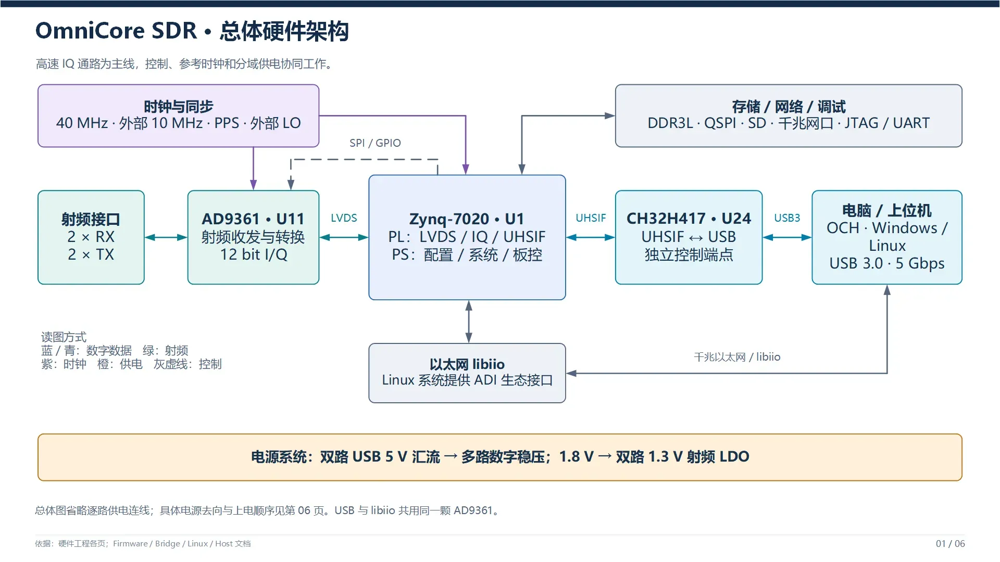
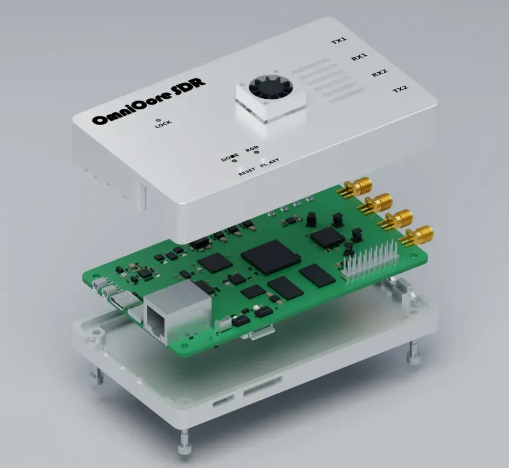
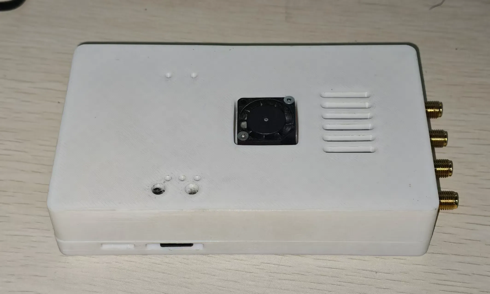

# OmniCore-SDR-Hardware

> **使用警告：未经许可，严禁发射。** 本开源项目仅供学习与研究使用。未经依法许可，严禁使用本设备进行无线电发射。使用者应遵守所在地无线电管理规定，不得干扰合法无线电业务。

OmniCore SDR 是一款基于 **AD9361 + Zynq-7020 + CH32H417** 的软件无线电收发平台，采用 8 层 PCB，集成双收双发射频链路、USB 3.0 高速通信、千兆以太网、外部参考时钟与独立 USB 调试接口。

本仓库提供硬件设计源文件与外壳结构文件，包括 Altium Designer 工程、原理图、PCB、集成元件库，以及 FDM / CNC 两套外壳的 STEP、STL 和配套图纸。固件、板端 Linux 和上位机分别维护在配套仓库中。

  

## 目录

- [硬件概览](#hardware-overview)
- [硬件架构](#hardware-architecture)
- [工程与原理图文件](#design-files)
- [PCB 工艺](#pcb)
- [3D 模型与外壳文件](#enclosure)
- [配套仓库](#related-projects)
- [开源协议](#license)

## 硬件概览

OmniCore SDR 围绕高速 IQ 数据传输、ADI 软件生态兼容以及灵活的时钟接口设计。USB 3.0 用于连接配套上位机；千兆以太网配合板端 Linux 提供 libiio 接口，可接入 GNU Radio、IIO Oscilloscope、pyadi-iio 等工具。

| 项目 | 配置与说明 |
| --- | --- |
| 射频收发器 | AD9361，2 路接收、2 路发射 |
| 采样率 | AD9361 配置下，每通道最高 61.44 MSPS；实际数据传输能力取决于通道组合、数据格式及配套固件 |
| 主控 | Zynq-7020（XC7Z020-2CLG400I），PL 负责高速数据处理，PS 负责系统与板级控制 |
| USB 桥接 | CH32H417，USB 3.0，链路标称速率 5 Gbit/s |
| 内存 | 两颗 MT41K256M16 DDR3L，32 bit 总线，合计 1 GiB |
| 启动与存储 | QSPI Flash、SD 卡 |
| 网络 | RTL8211FD 千兆以太网 PHY + RJ45 |
| 调试接口 | FT2232H，独立 USB 接口提供 JTAG / UART |
| 参考时钟 | 板载 40 MHz，支持外部 10 MHz 参考输入 |
| 同步与本振 | PPS 输入，RX / TX 独立外部本振接口 |
| 板级外设 | 温度监测、风扇接口、按键及 RGB 状态指示 |
| PCB | 8 层 FR4，成品板厚 1.6 mm |

61.44 MSPS 表示每通道采样率，不等同于可用射频带宽。如采用其他 AD936x 型号，通道数、频率范围与带宽应以实际装配器件为准。

## 硬件架构

  

### 射频与 IQ 数据链路

AD9361 通过匹配及巴伦网络连接射频接口，在芯片内部完成增益调整、上下变频、模数 / 数模转换及数字滤波。接收与发射 IQ 数据通过 LVDS 数据线、帧同步和接口时钟与 ZYNQ PL 交换，射频参数通过 SPI 及控制信号配置。

PL 完成 IQ 数据整理、缓冲与格式处理后，通过 32 bit UHSIF 总线及握手信号连接 CH32H417，再由 USB 3.0 传输至主机。配套固件支持 12 bit 紧凑打包及 8 bit 数据格式。

### ZYNQ 与系统外设

Zynq-7020 的 PS 端负责射频初始化、参数配置、板级控制和系统管理，可配合裸机 no-OS 或板端 Linux 使用。外围包括 DDR3L、QSPI Flash、SD 卡、千兆以太网，以及基于 FT2232H 的 JTAG / UART 调试电路。

**QSPI 选型说明：** 原设计标注 W25Q256，项目装配说明要求使用 **N25Q256 或 W25Q128**；选用时应与配套启动工程及镜像容量保持一致。

### USB 与 Type-C 接口

CH32H417 承担高速数据桥接和设备控制。Type-C 接口使用 HD3SS3220 完成 CC 检测与 SuperSpeed 差分通道切换，并配置 USB ESD 保护器件。高速数据口与 FT2232H 调试口各自承担数据通信和调试功能。

板卡使用 USB 提供的 5 V 电源，可用供电电流取决于供电端、线缆及 Type-C 电流声明。

### 参考时钟与同步

- **板载参考：** 以 40 MHz 振荡器为核心，为 AD9361 提供参考时钟。
- **外部参考：** 输入外部 10 MHz 后，ADF4002 通过鉴频鉴相及电荷泵环路调节板载振荡器，AD9361 仍使用 40 MHz 参考。
- **PPS 输入：** 为频偏、相位测量及配套固件的晶振驯服提供输入。
- **外部本振：** RX 和 TX 分别引出外部 LO 接口，可结合器件配置独立选择内部或外部本振。

仅使用 PPS 时，配套固件可通过 CH32 的 DAC 调谐晶振；接入外部 10 MHz 时，由固件协调释放 DAC 调谐节点，交给 ADF4002 环路控制。参考时钟、PPS 与外部 LO 分别承担不同功能。

### 电源架构

两路 USB 的 5 V 输入经 LTC4353 与外置 MOSFET 汇流，形成主电源。后级采用多路降压、低噪声 LDO 与分域滤波，分别为数字逻辑、DDR3L、射频及外围器件供电。

| 电源域 | 主要器件 | 用途 |
| --- | --- | --- |
| 5 V 主母线 | LTC4353 + 外置 MOSFET | 两路 USB 输入汇流，供给后级电源 |
| 1.0 V | LTM4622，两路输出并联 | ZYNQ 核心及 BRAM 电源 |
| 1.8 V | TPS82130 | ZYNQ 辅助 / 部分 I/O、AD9361 接口及射频 LDO 输入 |
| 3.3 V | TPS82130 | CH32、时钟、QSPI、SD 等外围电路 |
| 1.35 V | TPS82130 | DDR3L 及 ZYNQ DDR I/O |
| 1V3_A / 1V3_B | 两颗 TPS7A94 | AD9361 射频相关电源域 |
| DDRVTT / VTTREF | TPS51200 | DDR 终端电源与参考 |

电源使能按 1.0 V → 1.8 V → 3.3 V / 1.35 V 的顺序组织。

## 工程与原理图文件

硬件设计使用 **Altium Designer**。从 [OmniCore_SDR.PrjPcb](OmniCore_SDR.PrjPcb) 打开工程，可以统一查看原理图、PCB 与配套库文件。

### 工程、PCB 与元件库

| 文件 | 内容与用途 |
| --- | --- |
| [OmniCore_SDR.PrjPcb](OmniCore_SDR.PrjPcb) | Altium PCB 工程入口，组织原理图、PCB、元件库及工程设置。 |
| [OmniCore_SDR.PcbDoc](OmniCore_SDR.PcbDoc) | 主板 PCB 设计，包含板框、器件布局、布线、层叠及设计规则。 |
| [OmniCore_SDR.IntLib](OmniCore_SDR.IntLib) | 配套集成元件库，用于工程中的器件符号、封装及关联模型。 |

### 原理图

| 文件 | 内容与用途 |
| --- | --- |
| [AD9361.SchDoc](AD9361.SchDoc) | AD9361 主电路，包含数字接口、控制信号与供电去耦等连接。 |
| [AD9361_RF.SchDoc](AD9361_RF.SchDoc) | 射频收发接口、SMA 接口、匹配与巴伦网络。 |
| [PL_IO.SchDoc](PL_IO.SchDoc) | ZYNQ PL 侧 I/O 与高速数据连接，以及按键、RGB、风扇控制和 PPS 等信号。 |
| [PS_IO.SchDoc](PS_IO.SchDoc) | ZYNQ PS 侧 I/O、启动配置、QSPI 及系统控制相关电路。 |
| [DDR3.SchDoc](DDR3.SchDoc) | 两颗 DDR3L 的地址、数据、时钟与控制连接，以及 TPS51200 终端电源和去耦。 |
| [LAN_SD.SchDoc](LAN_SD.SchDoc) | RTL8211FD 千兆以太网、RJ45、MicroSD 与 QSPI Flash 电路。 |
| [JTAG.SchDoc](JTAG.SchDoc) | FT2232H USB 调试电路、JTAG / UART 连接及配套 EEPROM。 |
| [CH32H417_USB3.SchDoc](CH32H417_USB3.SchDoc) | CH32H417、UHSIF 总线、USB 3.0 Type-C 接口、HD3SS3220 与保护电路。 |
| [Clock.SchDoc](Clock.SchDoc) | 板载 40 MHz 参考、外部 10 MHz 输入、ADF4002 锁相与晶振调谐，以及 PPS、外部 RX / TX LO 连接。 |
| [Sys_Power.SchDoc](Sys_Power.SchDoc) | USB 电源汇流、系统降压与射频低噪声电源。 |
| [ZYNQ_Power.SchDoc](ZYNQ_Power.SchDoc) | ZYNQ 各电源域、I/O Bank 供电与去耦。 |

### 仓库说明文件

| 文件 | 内容与用途 |
| --- | --- |
| [README.md](README.md) | 硬件概览、工程文件索引、PCB 工艺和外壳模型说明。 |
| [LICENSE](LICENSE) | 硬件设计的 CERN-OHL-S-2.0 许可证全文。 |
| [.gitignore](.gitignore) | 排除 Altium 预览、历史记录、日志、工程输出及自动生成的工程结构文件。 |

仓库以设计源文件为主，未单独提供已导出的 Gerber、钻孔、BOM 和贴片坐标文件；生产资料需从对应版本的工程导出。`History/`、`__Previews/`、`Project Logs for */`、`Project Outputs for */` 属于本地生成内容，不作为仓库交付文件。

## PCB 工艺

以下参数依据项目的硬件生产说明整理，生产时应以所选版本的 PCB 工程及导出文件为准。

| 项目 | 参数 |
| --- | --- |
| 层数 | 8 层 |
| 板材 | FR4 |
| 成品板厚 | 1.6 mm |
| 铜厚 | 外层 1 oz，内层 0.5 oz |
| 表面处理 | 沉金 |
| 最小线宽 / 线距 | 4 mil / 4 mil |
| 过孔孔径 / 焊盘直径 | 8 mil / 16 mil，约 0.203 mm / 0.406 mm |
| 层叠方案 | 嘉立创 1080A / 华秋 1080 |

板上包含 BGA、QFN 和 0402 器件。射频走线、USB 3.0 差分线、AD9361 LVDS 与 DDR3 走线均与层叠和阻抗设计相关；转换到其他 EDA 格式或更换层叠时，需要同步核对封装、规则与走线参数。

## 3D 模型与外壳文件

[3D Model](3D%20Model/) 目录提供 **FDM** 与 **CNC** 两套结构文件，每套均包含上壳、下壳、按键和按键支架。按制作方式选择同一目录下的配套零件。

| 格式 | 用途 |
| --- | --- |
| `.step` | 三维 CAD 交换模型，便于结构查看、装配检查、尺寸调整和加工沟通。 |
| `.stl` | 三角网格模型，便于切片打印和三维预览。 |
| `.pdf` | 二维图纸，便于查看与沟通标注信息。 |
| `.dxf` | 二维轮廓或刻字图形，供对应加工环节使用。 |

仓库中的 STEP 与 DXF 均采用毫米单位；STL 导入切片或 CAD 软件时也应按毫米处理。

### FDM：3D 打印外壳

目录：[3D Model/FDM](3D%20Model/FDM/)。每个零件同时提供 STEP 与 STL 文件。

| 文件 | 零件与用途 |
| --- | --- |
| [FDM_Upper.step](3D%20Model/FDM/FDM_Upper.step) / [FDM_Upper.stl](3D%20Model/FDM/FDM_Upper.stl) | 打印版上壳，与下壳组成外壳主体。 |
| [FDM_Lower.step](3D%20Model/FDM/FDM_Lower.step) / [FDM_Lower.stl](3D%20Model/FDM/FDM_Lower.stl) | 打印版下壳，用于容纳与固定 PCB。 |
| [FDM_Button.step](3D%20Model/FDM/FDM_Button.step) / [FDM_Button.stl](3D%20Model/FDM/FDM_Button.stl) | 外壳按键件，将外部按压传递至 PCB 按键。 |
| [FDM_Button_Carrier.step](3D%20Model/FDM/FDM_Button_Carrier.step) / [FDM_Button_Carrier.stl](3D%20Model/FDM/FDM_Button_Carrier.stl) | 按键支架，用于按键件的安装与定位。 |

### CNC：机加工外壳与图纸

目录：[3D Model/CNC](3D%20Model/CNC/)。除三维模型外，还包含上壳 PDF 图纸与 DXF 图形文件。

| 文件 | 零件与用途 |
| --- | --- |
| [CNC_Upper.step](3D%20Model/CNC/CNC_Upper.step) / [CNC_Upper.stl](3D%20Model/CNC/CNC_Upper.stl) | CNC 版上壳的 CAD 与网格模型。 |
| [CNC_Lower.step](3D%20Model/CNC/CNC_Lower.step) / [CNC_Lower.stl](3D%20Model/CNC/CNC_Lower.stl) | CNC 版下壳的 CAD 与网格模型。 |
| [CNC_Button.step](3D%20Model/CNC/CNC_Button.step) / [CNC_Button.stl](3D%20Model/CNC/CNC_Button.stl) | CNC 版配套按键件。 |
| [CNC_Button_Carrier.step](3D%20Model/CNC/CNC_Button_Carrier.step) / [CNC_Button_Carrier.stl](3D%20Model/CNC/CNC_Button_Carrier.stl) | CNC 版配套按键支架。 |
| [CNC_Upper.pdf](3D%20Model/CNC/CNC_Upper.pdf) | CNC 上壳的二维图纸。 |
| [CNC_Upper_Laser_Drawing.dxf](3D%20Model/CNC/CNC_Upper_Laser_Drawing.dxf) | 上壳激光雕刻配套图，包含参考轮廓、尺寸、注释及雕刻图层。 |
| [02_ENGRAVE_ONLY_mm.dxf](3D%20Model/CNC/02_ENGRAVE_ONLY_mm.dxf) | 仅包含 `ENGRAVE` 图层的雕刻轮廓文件，便于交付激光雕刻加工。 |

STEP / STL 是几何模型，实际材料、表面处理、公差与加工工艺需结合图纸和装配要求确定。DXF 刻字文件应与对应版本上壳配套使用。

完整 DXF 中的 `REFERENCE`、`DIMENSIONS`、`ANNOTATION` 图层用于定位和说明；雕刻加工使用 `ENGRAVE` 图层或单独的纯雕刻文件。

### 外壳结构与配件

  

原项目的打印外壳采用螺丝与热熔螺母固定，预留风扇和 LED 导光柱位置。示例使用 **20 × 20 × 6 mm** 风扇，接口为 **1.25 mm 间距、3 Pin**。风扇控制能力取决于风扇型号及接线。

以下为原打印外壳装配示例的配件清单，CNC 版本及后续结构修改应以对应模型为准。

| 配件 | 安装位置 / 用途 | 规格 | 数量 |
| --- | --- | --- | ---: |
| 螺丝 | 主壳及 PCB 固定 | M3 × 10 | 4 颗 |
| 螺丝 | 按键支架固定 | M2 × 5 | 2 颗 |
| 螺丝 | 风扇固定 | M2 × 10 | 3 颗 |
| 热熔螺母 | 主壳固定 | RX-M3S × 4.0 | 4 颗 |
| 热熔螺母 | 按键支架固定 | RX-M2 × 4 | 2 颗 |
| 六角螺母 | 风扇固定 | M2 × 0.25 | 3 颗 |
| 导光柱 | 按键指示灯 | Ø2.0 × 17.1 mm | 3 根 |

按键件长度需与实际装配的 PCB 按键高度相匹配。展示照片及爆炸图来自项目原文，可能与仓库当前版本的 LED 数量、射频布局和外壳细节不同，尺寸与装配关系以当前设计文件为准。

  

## 配套仓库

| 仓库 | 内容 |
| --- | --- |
| [OmniCore-SDR-Hardware](https://github.com/Liren66/OmniCore-SDR-Hardware) | 本仓库：原理图、PCB、元件库及外壳结构文件。 |
| [OmniCore-SDR-Firmware](https://github.com/Liren66/OmniCore-SDR-Firmware) | ZYNQ FPGA 工程、PS 裸机程序、启动工程及 CH32H417 桥接固件。 |
| [OmniCore-SDR-Host](https://github.com/Liren66/OmniCore-SDR-Host) | Windows / Linux 上位机、命令行工具与 C/C++ SDK。 |
| [OmniCore-SDR-Linux](https://github.com/Liren66/OmniCore-SDR-Linux) | 板端 Linux、libiio 服务与镜像构建工具。 |
| [OmniCore-SDR-OnAir](https://github.com/Liren66/OmniCore-SDR-OnAir) | 适配 OmniCore SDR 的 OnAir 上位机分支。 |

## 开源协议

本项目硬件设计采用 **CERN-OHL-S-2.0**（CERN 开放硬件许可证 2.0，强互惠版本）开源。复制、修改、制作和分发相关设计或产品时，请遵守该协议的要求。

协议全文：[LICENSE](LICENSE)；标准文本来源：[SPDX · CERN-OHL-S-2.0](https://spdx.org/licenses/CERN-OHL-S-2.0.html)。软件、固件及第三方组件以各自仓库中的许可证和版权声明为准。
